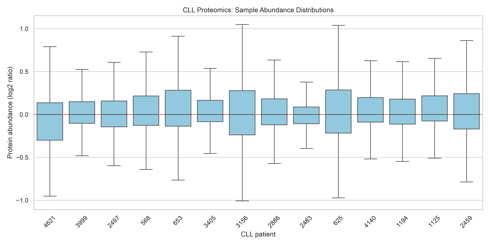
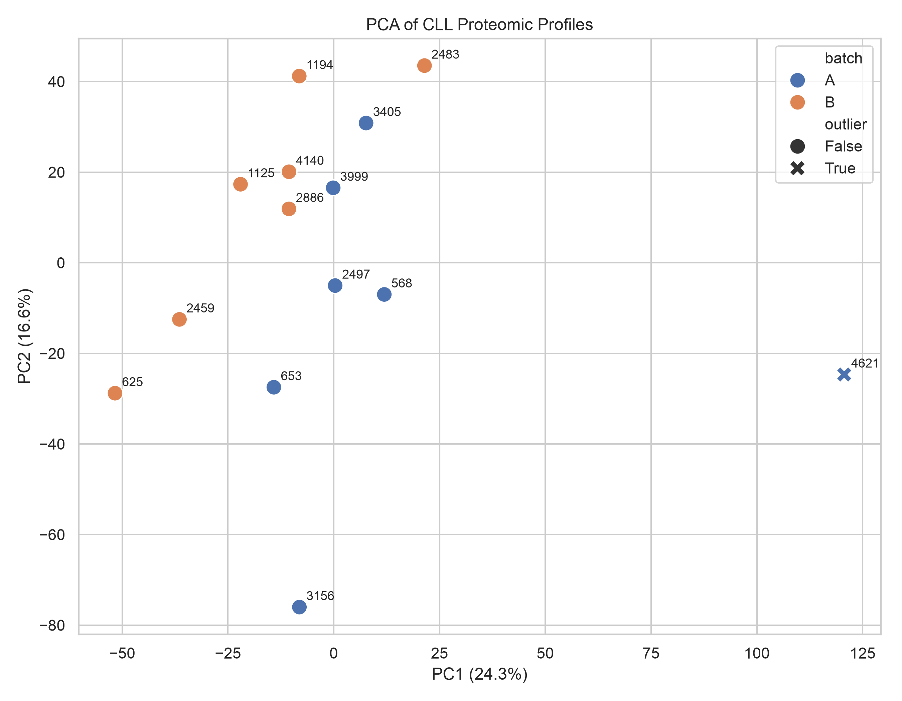
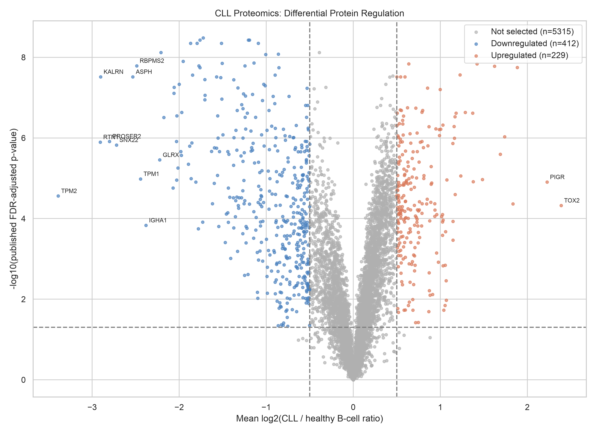
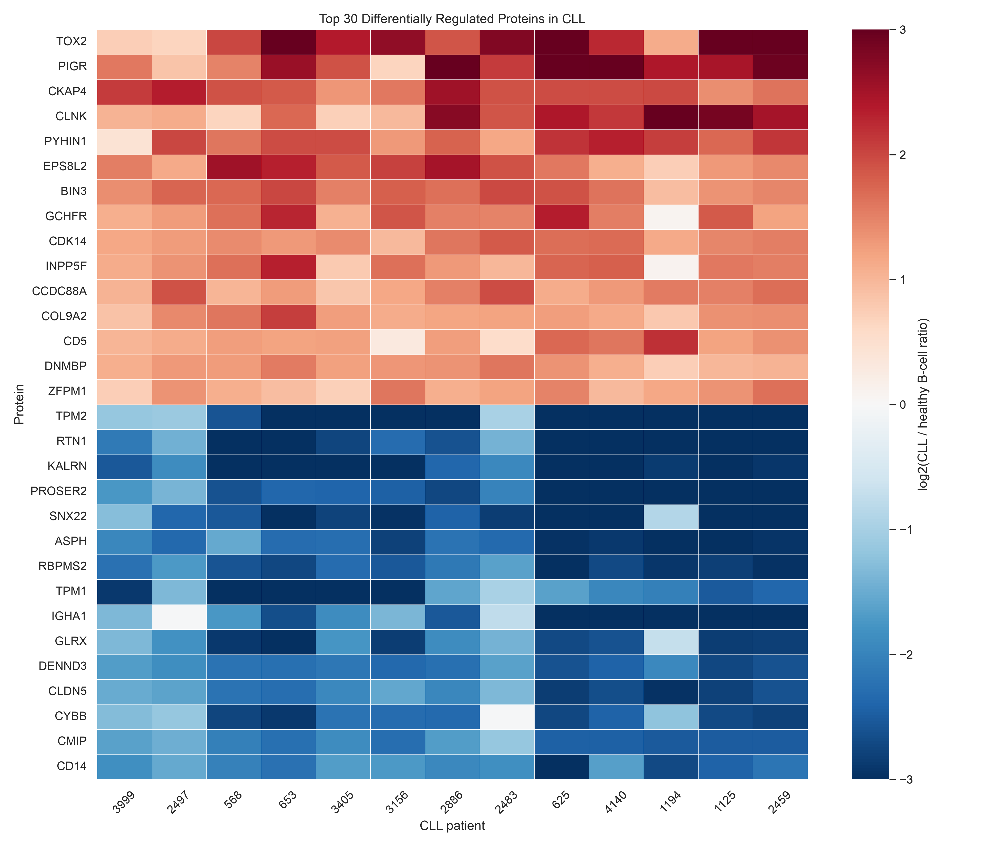
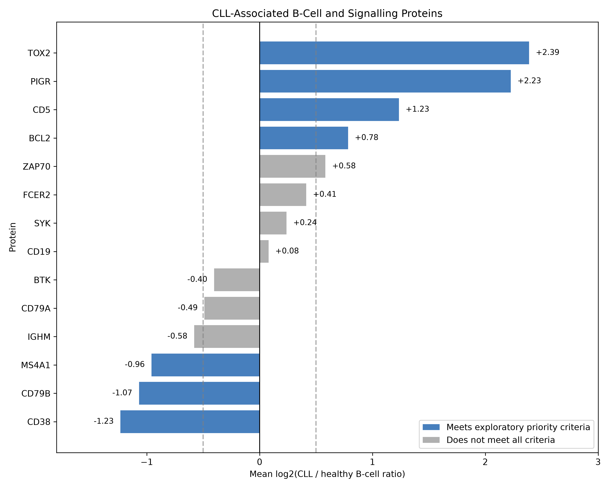

# CLL Proteomic Biomarker Discovery

Exploratory mass-spectrometry proteomics analysis of chronic
lymphocytic leukaemia (CLL), focusing on protein dysregulation,
candidate prioritisation and B-cell-associated proteins.

## Research objective

Identify consistently dysregulated proteins in CLL samples
relative to healthy donor B-cell references and explore their
potential biological relevance.

## Dataset

Johnston et al. (2018), Molecular & Cellular Proteomics.

DOI: https://doi.org/10.1074/mcp.RA117.000539

PRIDE accession: PXD002004

- 14 CLL patient samples
- Three healthy donor B-cell reference samples
- 5,956 quantified protein groups in Supplementary Table S2
- Two TMT experimental batches

The published study designated sample 4621 as an outlier.
The primary analysis therefore uses the remaining 13 patients.

## Analysis workflow

1. Inspect supplementary proteomics workbooks.
2. Extract protein-level log2 abundance ratios.
3. Perform sample-level QC and PCA.
4. Identify differentially regulated proteins using published
   FDR-adjusted p-values.
5. Generate a volcano plot and protein-abundance heatmap.
6. Prioritise proteins using effect size, consistency and
   unique-peptide support.
7. Examine a targeted panel of CLL-associated proteins.

## Main findings

- 5,956 quantified protein groups
- 3,707 proteins with published FDR < 0.05
- 641 exploratory candidates meeting FDR < 0.05 and
  absolute mean log2 ratio >= 0.5
- 229 upregulated and 412 downregulated candidates
- 558 proteins retained after additional consistency and
  unique-peptide criteria
- 14 CLL/B-cell-associated proteins examined in a targeted panel

Examples of proteins showing increased relative abundance
include TOX2, PIGR, CD5 and BCL2.

Examples showing decreased relative abundance include
RTN1, KALRN, CD38, CD79B and MS4A1.

## Figures

### Sample abundance distributions

### Principal component analysis

### Differential protein regulation

### Top 30 candidate proteins

### Targeted CLL protein panel

## Methods and limitations

Protein measurements are published log2 abundance ratios
relative to healthy donor B-cell references, not independently
available raw control intensities.

Published FDR-adjusted p-values were reused; this project
does not independently reproduce the original statistical
testing or raw mass-spectrometry processing.

Candidate thresholds are exploratory and do not establish
clinical diagnostic or prognostic performance.

The study concerns CLL, not monoclonal B-cell lymphocytosis
(MBL). Findings cannot be assumed to generalise to MBL.

The cohort is small, includes two TMT batches, and has no
independent validation cohort in this analysis.

## Technologies

Python, pandas, NumPy, SciPy, scikit-learn, Matplotlib,
Seaborn, mass-spectrometry proteomics, PCA and exploratory
biomarker prioritisation.

## Reference

Johnston HE et al. (2018).
Proteomics Profiling of CLL Versus Healthy B-cells Identifies
Putative Therapeutic Targets and a Subtype-independent
Signature of Spliceosome Dysregulation.

Molecular & Cellular Proteomics.
https://doi.org/10.1074/mcp.RA117.000539
